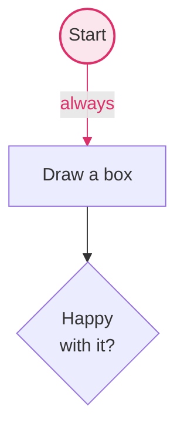

# FlowYo

A browser flowchart editor. Drag circles, squares and diamonds onto a canvas, wire them
together, and the chart is rendered as SVG and stored as **mermaid** in your browser's
local storage.

The app is a single self-contained `index.html` — no build step, no runtime dependencies.
Open it in a browser and it works.

```
open index.html          # or: pnpm start
```

## Using it

| | |
|---|---|
| add a shape | drag one from the toolbar, or click it to drop one in the middle; **⌥A C S D P** adds one from the keyboard |
| change a shape | select it and press **C** (circle), **S** (square), **D** (diamond) or **P** (person) — an arrow is not a shape you convert *to*, only one you add |
| move a shape | drag it (snaps to a 10px grid; hold **⌘/ctrl** to place freely) |
| select several | drag a box across the canvas; **shift + click** adds one; they move, recolour and delete together |
| copy a shape | **⌥/alt + drag** it |
| connect two shapes | drag a blue handle onto another shape |
| grow the next shape | select one and press **↑ → ↓ ←** — the same as clicking that handle |
| flip an arrow's ends | select it and press **space**: one way → both ways → two lines with their own labels |
| add a connected shape | click a blue handle, or drop it on empty canvas |
| label something | double-click a shape or an arrow; **shift + enter** for a line break |
| recolour something | select it, then a swatch or keys **1**–**4** |
| delete something | select it and press **Delete** |
| undo / redo | **⌘Z** and **⇧⌘Z** (or ctrl), or the two arrows in the toolbar |
| keep several charts | the name button in the toolbar — switch, add, rename, duplicate, delete |
| import a chart | **Import mermaid…** in that menu — paste it, then add it or replace this one |
| copy the chart | the **Copy** button (**⇧⌘C**) — the caret beside it picks image, Markdown, mermaid or SVG, and that choice sticks |
| download it | **Export…** from the caret or the chart menu — the same four formats as files |
| empty a chart | **Clear this chart** in the chart menu (undoable) |
| navigate | **⌥/alt + drag** or scroll to pan, **⌘/ctrl + scroll** to zoom, **Fit** to frame it |
| on a phone | drag to move, tap to select, double-tap to label, pinch to zoom, one finger on empty canvas to pan |

Colours come from a five-tone palette: beige is the paper, gunmetal the ink, and cobalt
blue, razzmatazz and royal gold colour the shapes — a bright border over a faded fill.
Light mode deepens the gold border slightly so it reads on the beige canvas; everything
exported to mermaid uses the true palette hex.

## The shapes

Circle, square and diamond are the usual flowchart three. Two more:

- **Person** — a head-and-shoulders figure with its name underneath. It connects like any
  other shape.
- **Arrow** — a free-standing, labelled arrow that belongs to nowhere: drag it anywhere, drag
  either end to re-aim it, double-click to label it. Nothing connects *to* an arrow; it is an
  annotation, not a step.

Arrows and connectors share three end styles, cycled with **space**:

| | |
|---|---|
| one way | a single line with one head |
| both ways | a single line with a head at each end |
| two lines | one line each way, each with its own label — placed so the two can never overlap |

## On a touch screen

It works by thumb. A few things are deliberately different from the mouse:

- Connector handles appear when you **tap a shape** (there is no hover to reveal them) and
  sit *outside* the outline, so the middle of a shape always means "move me". Touch
  hit-testing is fuzzy — browsers will happily snap a fingertip onto a small target tens of
  pixels away — so the app also measures where your finger actually landed before deciding
  you meant a handle.
- **Double-tap** renames a shape or an arrow. A prevented touch `pointerdown` never becomes
  a `dblclick`, and the second tap is only recognised as one once the gesture ends — at
  `pointerdown` a second tap and the start of a drag look identical.
- **Pinch** zooms and pans together; a second finger landing mid-drag hands over to the
  pinch and leaves the shape where it was.
- The toolbar wraps instead of scrolling, so nothing hides off the edge, and the zoom
  buttons drop out (pinch replaces them).

Alt-drag to copy and shift-drag to ignore the grid have no touch equivalent yet.

## Storage format

Charts live in `localStorage` as an index plus one document each:

```
flowyo:charts:v1   {"current":"c2","charts":[{"id":"c1","name":"Getting started"}, …]}
flowyo:chart:c1    the mermaid source of that chart
flowyo:chart:c2    …
```

Each document *is* the chart's mermaid source, so it can be pasted into any mermaid
renderer as-is:



The **Copy** button puts any of that on the clipboard in one click — the image by default,
or whichever format you picked last. **Export…** gives you the same four as downloads,
with a preview.

Shapes mermaid cannot spell are written as the nearest thing it can plus a `%%` note:
a person is a box with `%% shape <id> person` beside it, and a free arrow — which has no
mermaid equivalent at all — lives entirely in a `%% arrow` line, so a chart pasted elsewhere
is still a clean flowchart. A two-way connector is mermaid's own `<-->`; a two-line pair is
written as two ordinary links, and reading two opposite links back in makes a pair again.

Shapes, labels (with `<br/>` line breaks) and colours are all real mermaid. Only the
hand-placed coordinates live in `%%` comments, which mermaid ignores — so nothing is lost
when the file travels, and reopening it in FlowYo puts every shape back where you left it.
A chart pasted in *without* `%% pos` lines is laid out automatically.

## Tests

End-to-end suites drive a real browser with Playwright — clicking, dragging and typing the
way a person would — and check both the rendered SVG and the serialized mermaid.

```
corepack enable pnpm                  # once, if you don't have pnpm
pnpm install
pnpm exec playwright install chromium # one-off: fetch the browser
pnpm test                             # all suites
pnpm test colour                      # just the ones matching "colour"
node tests/04-colour.test.js          # or run a single suite directly
HEADED=1 pnpm test                    # watch it happen in a real window
```

pnpm is pinned through the `packageManager` field, so corepack picks the right version
on its own. Dependency build scripts stay blocked (`onlyBuiltDependencies: []` in
`pnpm-workspace.yaml`, which is where pnpm 11 reads it) — Playwright's browser download is
run explicitly by the command above, not by a postinstall hook, so nothing needs unblocking.
`CHROMIUM_PATH=/path/to/chrome` runs the suites against a browser Playwright did not fetch.

| suite | covers |
|---|---|
| `01-canvas` | placing, dragging, zoom/pan, delete, the mermaid round trip, auto-layout on import |
| `02-labels` | arrow labels, soft line breaks, alt-drag copies |
| `03-connectors` | growing a connected shape from a handle, centred connector labels |
| `04-colour` | palette defaults, swatches, keyboard, colour in the serialized output |
| `05-mermaid` | hands FlowYo's output to the **real mermaid library** and asks it to parse |
| `06-undo` | the history stack: every mutation, the redo tail, and ⌘Z inside the label editor |
| `07-charts` | the chart library: switching, renaming, duplicating, deleting, migration |
| `08-import` | pasting mermaid in: what it accepts, what it refuses, and where it lands |
| `09-export` | all four formats: content, the real downloaded files, and the PNG bytes |
| `10-copy-button` | the Copy split-button: default action, remembered format, clipboard fallback |
| `11-touch` | an emulated phone driven by real touch events: dragging, connecting, double-tap, pinch, layout |
| `12-shapes` | the person and the free arrow: drawing, endpoints, end styles, the mermaid round trip |
| `13-multiselect` | the rubber band: picking up groups, moving, recolouring, deleting and copying them |
| `14-shortcuts` | every key: ⌥ to add, a letter to convert, arrows to grow, space to cycle |

Anything typed into a field goes through `t.selectAll()` rather than a hard-coded
`Control+a`: on macOS ctrl+A means "move to start of line", so a literal ctrl+A silently
prepends the new text instead of replacing it. The helper uses Playwright's
`ControlOrMeta`.

Playwright types on a US layout, so the layout-independence checks in `14-shortcuts`
dispatch the key/code pairs other layouts actually produce (on Dvorak the key marked C
reports `KeyI`; on macOS ⌥C arrives as "ç").

`tests/harness.js` holds the shared bits: it launches the browser, clears storage, collects
console and page errors, and exposes helpers (`centre`, `hoverAnchor`, `edgePoint`, `fit`).
A suite marked `{ touch: true }` gets an emulated iPhone plus `t.touch` — tap, doubleTap,
drag and pinch, dispatched through CDP as genuine touch events with a **14px finger
radius**, because the bugs that only bite real thumbs vanish if you dispatch a 1px point.
A suite exits non-zero if any check fails, and drops a screenshot into `tests/screenshots/`
when something goes wrong.

The app itself has no dependencies; `mermaid` and `playwright` are dev-only, for the tests.

## CI

`.github/workflows/ci.yml` runs `pnpm test` on every push and pull request against
`ubuntu-latest`, caching the Chromium download and uploading failure screenshots as an
artifact. Playwright is pinned to an exact version so the browser cache key stays honest —
bump it deliberately.

## Layout

```
index.html                  the whole app
tests/                      Playwright suites + harness
.github/workflows/ci.yml    the CI run
TODO.md                     what's shipped and what's next
```
