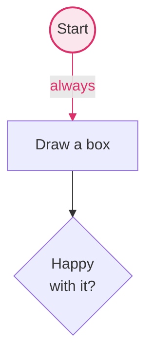

# FlowYo

A browser flowchart editor. Drag circles, squares and diamonds onto a canvas, wire them
together, and the chart is rendered as SVG and stored as **mermaid** in your browser's
local storage.

The app is a single self-contained `index.html` — no build step, no runtime dependencies.
Open it in a browser and it works.

```
open index.html          # or: pnpm start
```

## Using it

| | |
|---|---|
| add a shape | drag one from the toolbar, or click it to drop one in the middle |
| move a shape | drag it (snaps to a 10px grid; hold **shift** to place freely) |
| copy a shape | **⌥/alt + drag** it |
| connect two shapes | drag a blue handle onto another shape |
| add a connected shape | click a blue handle, or drop it on empty canvas |
| label something | double-click a shape or an arrow; **shift + enter** for a line break |
| recolour something | select it, then a swatch or keys **1**–**4** |
| delete something | select it and press **Delete** |
| undo / redo | **⌘Z** and **⇧⌘Z** (or ctrl), or the two arrows in the toolbar |
| navigate | drag empty space to pan, **⌘/ctrl + scroll** to zoom, **Fit** to frame it |

Colours come from a five-tone palette: beige is the paper, gunmetal the ink, and cobalt
blue, razzmatazz and royal gold colour the shapes — a bright border over a faded fill.
Light mode deepens the gold border slightly so it reads on the beige canvas; everything
exported to mermaid uses the true palette hex.

## Storage format

The autosaved value in `localStorage["flowyo:chart:v1"]` *is* the chart's mermaid source,
so it can be pasted into any mermaid renderer as-is:



Shapes, labels (with `<br/>` line breaks) and colours are all real mermaid. Only the
hand-placed coordinates live in `%%` comments, which mermaid ignores — so nothing is lost
when the file travels, and reopening it in FlowYo puts every shape back where you left it.
A chart pasted in *without* `%% pos` lines is laid out automatically.

## Tests

End-to-end suites drive a real browser with Playwright — clicking, dragging and typing the
way a person would — and check both the rendered SVG and the serialized mermaid.

```
corepack enable pnpm                  # once, if you don't have pnpm
pnpm install
pnpm exec playwright install chromium # one-off: fetch the browser
pnpm test                             # all suites
pnpm test colour                      # just the ones matching "colour"
node tests/04-colour.test.js          # or run a single suite directly
HEADED=1 pnpm test                    # watch it happen in a real window
```

pnpm is pinned through the `packageManager` field, so corepack picks the right version
on its own. Dependency build scripts stay blocked (`pnpm.onlyBuiltDependencies: []`) —
Playwright's browser download is run explicitly by the command above, not by a postinstall
hook, so nothing needs unblocking.

| suite | covers |
|---|---|
| `01-canvas` | placing, dragging, zoom/pan, delete, the mermaid round trip, auto-layout on import |
| `02-labels` | arrow labels, soft line breaks, alt-drag copies |
| `03-connectors` | growing a connected shape from a handle, centred connector labels |
| `04-colour` | palette defaults, swatches, keyboard, colour in the serialized output |
| `05-mermaid` | hands FlowYo's output to the **real mermaid library** and asks it to parse |
| `06-undo` | the history stack: every mutation, the redo tail, and ⌘Z inside the label editor |

Anything typed into a field goes through `t.selectAll()` rather than a hard-coded
`Control+a`: on macOS ctrl+A means "move to start of line", so a literal ctrl+A silently
prepends the new text instead of replacing it. The helper uses Playwright's
`ControlOrMeta`.

`tests/harness.js` holds the shared bits: it launches the browser, clears storage, collects
console and page errors, and exposes helpers (`centre`, `hoverAnchor`, `edgePoint`, `fit`).
A suite exits non-zero if any check fails, and drops a screenshot into `tests/screenshots/`
when something goes wrong.

The app itself has no dependencies; `mermaid` and `playwright` are dev-only, for the tests.

## CI

`.github/workflows/ci.yml` runs `pnpm test` on every push and pull request against
`ubuntu-latest`, caching the Chromium download and uploading failure screenshots as an
artifact. Playwright is pinned to an exact version so the browser cache key stays honest —
bump it deliberately.

## Layout

```
index.html                  the whole app
tests/                      Playwright suites + harness
.github/workflows/ci.yml    the CI run
TODO.md                     what's shipped and what's next
```
